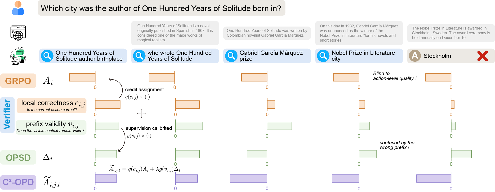
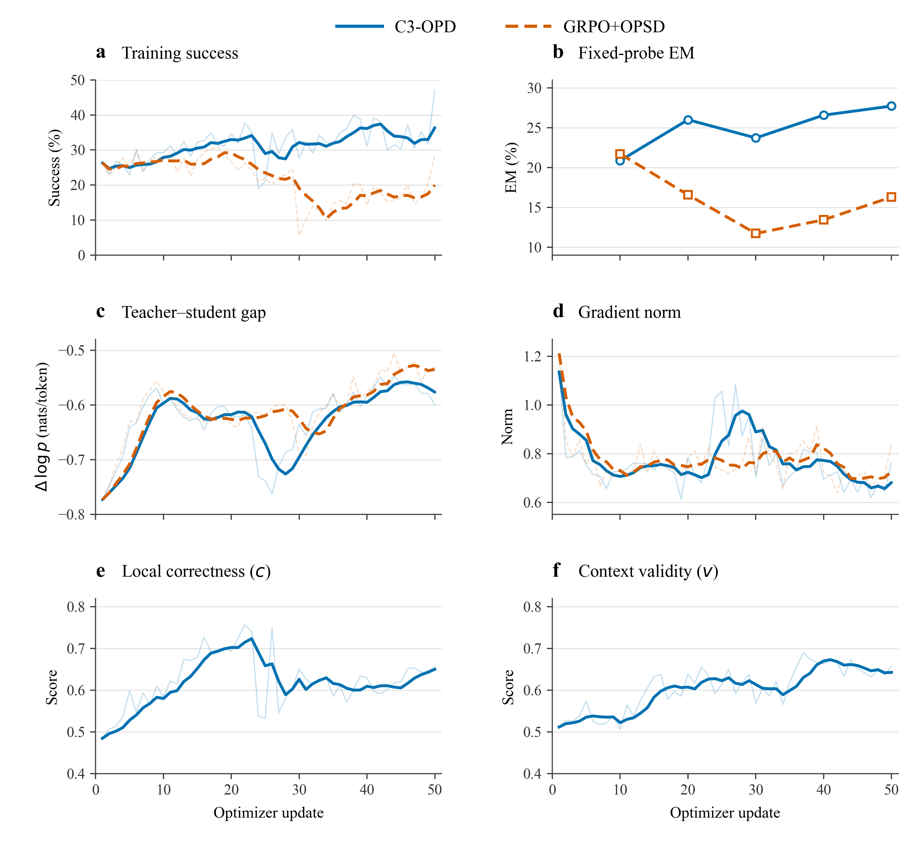

# C3-OPD: Credit-Calibrated On-Policy Distillation for Search-QA

**A source release of C3-OPD and its independently trained GRPO+OPSD ablation.**

This repository contains the method-specific code, configuration templates, and publication figures for two 50-update Search-QA experiments. C3-OPD couples trajectory-level GRPO with action-level correctness calibration and context-gated on-policy skill distillation. The ablation retains GRPO and Teacher token supervision while removing the Verifier and setting both calibration weights to one.

| model | Correct / 51,713 | Micro EM | Seven-task macro EM |
|---|---:|---:|---:|
| **C3-OPD** | **17,719** | **34.2641%** | **28.8180%** |
| GRPO+OPSD | 12,089 | 23.3771% | 19.5778% |

Both models start from the original **Qwen3-1.7B** weights. The ablation does **not** initialize from the C3-OPD checkpoint. Results are from one run per variant; the observed differences are not a multi-seed significance claim.

## Contents

- [1. Background and motivation](#1-background-and-motivation)
- [2. Method](#2-method)
- [3. Experimental protocol](#3-experimental-protocol)
- [4. Results and training dynamics](#4-results-and-training-dynamics)
- [5. Code organization](#5-code-organization)
- [6. Reproduction](#6-reproduction)
- [7. Release scope and attribution](#7-release-scope-and-attribution)

## 1. Background and motivation

Search agents must assign credit across a sequence of queries, retrieved observations, and a terminal answer. An outcome-level GRPO advantage provides a shared trajectory signal, but does not distinguish locally useful actions from unsupported or redundant ones. On-policy distillation supplies dense token-level supervision; its usefulness also depends on whether the visible interaction context remains consistent with solving the task.

C3-OPD introduces two action-level signals to calibrate these complementary sources of supervision:

1. **Local correctness** $c$: whether the current projected action is appropriate.
2. **Visible-context validity** $v$: whether the recent action–observation context remains consistent with a correct solution.

<p align="center">
  
</p>

*Conceptual illustration. The equations below specify the implemented previous-turn gate and independent invalid-action penalty; the illustrated interaction length is not the experiment's four-step limit.*

## 2. Method

C3-OPD assigns credit at three levels: trajectory outcomes, action verification, and sampled response tokens. Following the four-stage formulation, the implemented Search-QA pipeline is **Teacher verification → GRPO assignment → gated OPSD → credit fusion and policy update**.

Let $i$ index a trajectory, $j$ an environment turn, and $t$ a response token belonging to turn $j$. Action-level signals operate on projected actions; token-level distillation retains the original response, including thinking.

### 2.1 Stage 1 — Teacher action-level verification

#### Local correctness

The frozen **Qwen3-VL-8B-Instruct** Teacher judges the current projected action using the question, task skills, current observation, and recent observation–action history. The action's resulting observation is withheld, and Student thinking is omitted. With Teacher logits for the single-token labels **A = Correct** and **B = Incorrect**:

```math
c_{ij}=\frac{\exp(\ell^{A,c}_{ij})}
{\exp(\ell^{A,c}_{ij})+\exp(\ell^{B,c}_{ij})}.
```

#### Visible-context validity

A separate prompt includes the current action's resulting observation and uses **A = Valid**, **B = Invalid**:

```math
v_{ij}=\frac{\exp(\ell^{A,v}_{ij})}
{\exp(\ell^{A,v}_{ij})+\exp(\ell^{B,v}_{ij})}.
```

Both prompts use the Student environment's bounded history of four preceding turns. Thus, $v$ measures **visible-window consistency** with solving the task. Privileged inputs contain task skills; evaluation gold answers are not supplied to the Verifier. Exact prompts are in [the Search-QA Verifier template](overlay/agent_system/prompts/c3_verifier_templates_search.json).

### 2.2 Stage 2 — GRPO reward assignment

#### Trajectory-level outcome credit

For a group of $G$ trajectories answering the same question, the environment provides binary episode rewards. The original GRPO advantage uses the population standard deviation:

```math
\mu_R=\frac{1}{G}\sum_{k=1}^{G}R_k,\qquad
\sigma_R=\sqrt{\frac{1}{G}\sum_{k=1}^{G}(R_k-\mu_R)^2},\qquad
A_i=\frac{R_i-\mu_R}{\sigma_R+10^{-6}}.
```

C3-OPD preserves this trajectory-level definition and applies action calibration afterward.

#### Token-weighted action calibration

Let $L_{ij}$ count tokens retained by the original response mask. Local correctness redistributes the trajectory advantage through a bounded, sign-aware centered score:

```math
\overline c_i=\frac{\sum_j L_{ij}c_{ij}}{\sum_j L_{ij}},\qquad
h_{ij}=\tanh\left(\frac{\mathrm{sign}(A_i)(c_{ij}-\overline c_i)}{\tau}\right).
```

```math
\overline h_i=\frac{\sum_j L_{ij}h_{ij}}{\sum_j L_{ij}},\qquad
q_{ij}=1+\rho(h_{ij}-\overline h_i),\qquad
A^{\mathrm{GRPO}}_{ij}=q_{ij}A_i.
```

The final experiments use **$\rho=1.0$ and $\tau=1.0$**. Token-weighted mean calibration is preserved:

```math
\frac{\sum_j L_{ij}q_{ij}}{\sum_j L_{ij}}=1.
```

The implementation checks an error tolerance of $2\times10^{-6}$ and rejects nonpositive or nonfinite actual weights. Entire question groups with identical binary rewards skip local scoring under the existing zero-GRPO-advantage rule.

### 2.3 Stage 3 — Visible-context-gated OPSD

#### Token-level Teacher credit

The Teacher scores the same sampled response tokens with task skills supplied as privileged information. The distillation credit is the Teacher–sampled-Student log-probability gap:

```math
\Delta_{it}=\log p_T(y_{it})-\log p_{\mathrm{Student,sampled}}(y_{it}).
```

The Teacher receives the current Student turn prompt and its bounded history plus task skills. Thinking remains in the original token-scoring and response-mask path.

#### Previous-turn validity gate

The preceding turn's context validity controls distillation on the current turn, with a unit first-turn gate:

```math
g_{i1}=1,\qquad g_{ij}=v_{i,j-1}\quad(j>1),\qquad
A^{\mathrm{OPSD}}_{it}=g_{ij}\Delta_{it}.
```

An unreliable context reduces Teacher credit on the following turn. The gate remains a bounded-window approximation.

### 2.4 Stage 4 — Three-level credit fusion

#### Unified token advantage

For token $t$ in turn $j$, combine calibrated GRPO, gated Teacher credit, and the independent invalid-action penalty:

```math
\widetilde A_{it}=
\left[
A^{\mathrm{GRPO}}_{ij}
+\lambda(s)A^{\mathrm{OPSD}}_{it}
-\beta\,\mathrm{invalid}_{ij}
\right]M_{it}.
```

Equivalently, the implemented C3-OPD credit is

```math
\widetilde A_{it}=
\left[
q_{ij}A_i+\lambda(s)g_{ij}\Delta_{it}
-\beta\,\mathrm{invalid}_{ij}
\right]M_{it},\qquad
\beta=0.1.
```

Here $M_{it}$ is the original response mask. The Teacher coefficient decays across the 50 updates:

```math
\lambda(s)=0.10-0.05\min(s/50,1).
```

#### Policy update and masking

The fused advantage enters the existing GRPO/PPO clipped policy update. Action parsing is restricted to content outside thinking and fails closed on malformed boundaries. The invalid-action term is applied **after fusion and before masking**; reward-level invalid penalties are disabled. The fused advantage is used directly, without subsequent recentering or forced sign changes.

### 2.5 GRPO+OPSD ablation

The ablation removes all Verifier local/valid scoring and sets **$q=g=1$**:

```math
\widetilde A_{it}^{\mathrm{ablation}}=
\left[A_i+\lambda(s)\Delta_{it}-0.1\,\mathrm{invalid}_{ij}\right]M_{it}.
```

Teacher token supervision, initialization, workload, learning rate, parser, thinking, masks, retrieval, and the $\lambda/\beta$ schedules remain matched. The ablation has no measured $c/v$ signals; they are not fabricated as zeros in the figures.

## 3. Experimental protocol

### 3.1 Training

| Setting | Matched value |
|---|---|
| Student / frozen Teacher | Qwen3-1.7B / Qwen3-VL-8B-Instruct |
| Student initialization | Original HF snapshot `70d244cc86ccca08cf5af4e1e306ecf908b1ad5e`; resume disabled |
| Hardware | Four NVIDIA L20 GPUs; 46,068 MiB per GPU |
| Student / scorer topology | Four NO_SHARD Student replicas, TP1 rollout; Teacher TP1×DP4 |
| Training data | Original processed Search-QA train split; 169,615 rows |
| Complete optimizer updates | 50 |
| Tasks × trajectories | 128 × 8 = 1,024 per update |
| PPO mini-batch / per-GPU micro-batch | 256 / 4; one PPO epoch |
| Learning rate / weight decay | $10^{-6}$ / 0.01 |
| Gradient clip / PPO clip | 1.0 / 0.2 |
| Entropy / actor KL coefficient | 0.001 / 0.001; `low_var_kl` |
| Prompt / response / Student context | 4,096 / 1,024 / 8,192 tokens |
| Maximum steps / history | 4 / 4 |
| Scorer context | 40,960 tokens; colocated offload/sleep |
| Retrieval | Full 21,015,324-document Wiki18; CPU FP32 exact `IndexFlatIP`; top3 |
| Checkpoint / fixed-probe interval | Every 10 updates |

### 3.2 Evaluation

The final evaluation uses each variant's own **step50 full rank0 checkpoint** on the same original **51,713-question** test split. Four TP1 Student workers process 128 questions per worker, with seed0 ordering across **405 chunks**. Teacher and Verifier are not used during evaluation.

Greedy decoding is fixed at `do_sample=false`, `temperature=0`, `top_p=1`, `top_k=-1`, `min_p=0`, and `n=1`. Evaluation preserves the four-step environment, four-turn history, top3 retrieval, and 4,096/1,024/8,192 token limits.

Each question contributes one episode. Correctness is the original SearchEnv's **last-active native normalized exact match**, with binary `episode_reward == correct`; raw answers are not rescored to overwrite native correctness. **Micro EM** weights all questions equally; **macro EM** averages the seven task accuracies equally.

## 4. Results and training dynamics

### 4.1 Full-test results

| Task | nq | triviaqa | popqa | hotpotqa | 2wikimultihopqa | musique | bamboogle | **Micro** | **Macro** |
|---|---:|---:|---:|---:|---:|---:|---:|---:|---:|
| Questions | 3,610 | 11,313 | 14,267 | 7,405 | 12,576 | 2,417 | 125 | **51,713** | Seven tasks |
| C3-OPD correct | 1,138 | 5,524 | 5,296 | 2,053 | 3,489 | 193 | 26 | **17,719** | — |
| C3-OPD EM | 31.5235% | 48.8288% | 37.1206% | 27.7245% | 27.7433% | 7.9851% | 20.8000% | **34.2641%** | **28.8180%** |
| GRPO+OPSD correct | 791 | 3,301 | 4,260 | 1,121 | 2,535 | 58 | 23 | **12,089** | — |
| GRPO+OPSD EM | 21.9114% | 29.1788% | 29.8591% | 15.1384% | 20.1574% | 2.3997% | 18.4000% | **23.3771%** | **19.5778%** |

C3-OPD answers **5,630 more questions correctly**, an observed difference of **+10.8870 percentage points micro EM** and **+9.2402 points macro EM**. This controlled comparison removes the Verifier-derived calibration while retaining Teacher distillation. It does not establish a multi-seed effect size or statistical significance.

### 4.2 Training dynamics



**a** Training episode success. **b** Fixed 350-question greedy-probe EM. **c** Response-mask-weighted Teacher–Student log-probability gap. **d** Actor gradient norm. **e** Local correctness $c$. **f** Context validity $v$.

Faint curves show the recorded per-update values; darker curves show a trailing five-update mean, using available updates at the beginning. Probe markers are the five actual evaluations. Panels e/f use valid unique turns, excluding padding duplicates; c includes only turns actually scored locally. Only C3-OPD has c/v observations. No uncertainty band is implied by these single-run traces. [Download the vector PDF](figures/training_dynamics.pdf).

The training-success and held-out-probe trajectories separate later in training. The five fixed-probe correct counts are **73/91/83/93/97** for C3-OPD and **76/58/41/47/57** for GRPO+OPSD. These 350-question probes are diagnostic measurements and are not pooled with the final full-test EM.

### 4.3 Completion and result integrity

Both training runs completed all 50 updates, five probes, five complete checkpoints, and trainer exit0. Full evaluations independently checked the original question/gold/source identities, unique row coverage, seed0 chunk order, native reward/correct consistency, finite records, action/turn alignment, and actual greedy decoding.

The C3 full evaluation initially encountered a supervisor `/proc/cwd` exit race **after all 405 scoring chunks had been committed**. Its original supervisor exit1 and worker codes `[0, -15, 0, 0]` were preserved; an independent finalizer validated the committed results and exited0 without rerunning inference or changing correctness. The ablation full evaluation completed with **driver exit0 and four worker exit0**. Raw evidence remains in the private experiment archive and is not part of this source-only release.

## 5. Code organization

```text
.
├── overlay/                     # Final experiment's SDAR/verl source overlay
│   ├── verl/trainer/ppo/        # Credit fusion, scoring inputs, fixed probe, RLSD/PPO support
│   ├── verl/workers/            # Teacher/Verifier service and four-replica execution
│   ├── agent_system/           # Thinking-isolated Search-QA parser, prompts, rollout support
│   ├── skills/search/          # Static task-skill prompts; no benchmark question records
│   └── examples/search/        # Batched exact retrieval service
├── ablation/                   # Teacher-only trainer, scorer, and training entry point
├── configs/                    # Matched portable 50-update configuration templates
├── evaluation/evaluate.py      # Four-worker native greedy full-test evaluation
├── scripts/                    # Overlay installation, probe preparation, training launcher
└── figures/                    # Method PNG, six-panel PNG/PDF, plotting source
```

The central implementations are [C3 credit fusion](overlay/verl/trainer/ppo/c3_opsd_ray_trainer.py), [Verifier/Teacher scoring](overlay/verl/workers/c3_external_scorer.py), [scorer inputs](overlay/verl/trainer/ppo/c3_scoring_inputs.py), [Teacher-only ablation](ablation/grpo_opsd_trainer.py), and [thinking-isolated action projection](overlay/agent_system/environments/env_package/search/projection.py).

## 6. Reproduction

### 6.1 Framework and environments

This is a **method-specific source overlay**, not a vendored copy of the entire framework. Obtain the [SDAR framework](https://github.com/ZJU-REAL/SDAR), provision its dependencies in a Linux CUDA environment, and apply this overlay before running either variant.

```bash
git clone https://github.com/pwenss/C3-OPD.git
cd C3-OPD
git clone https://github.com/ZJU-REAL/SDAR.git framework/SDAR
export SDAR_ROOT="$PWD/framework/SDAR"
python scripts/apply_overlay.py --sdar-root "$SDAR_ROOT"       # review changes
python scripts/apply_overlay.py --sdar-root "$SDAR_ROOT" --apply
```

The overlay installer keeps a local backup of existing overwritten files. The experimental deployment used separate Student and scorer environments:

| Component | Observed deployment version |
|---|---|
| Student PyTorch | `2.7.0a0+7c8ec84dab.nv25.3` (NVIDIA build) |
| Student vLLM / Ray | `0.9.2` / `2.58.0` |
| Student Transformers / TensorDict | `4.51.1` / `0.6.2` |
| Scorer PyTorch / vLLM | `2.8.0` / `0.11.0` |
| Scorer Transformers | `4.57.6` |
| Hydra / PyArrow / Faiss CPU | `1.3.7` / `25.0.1` / `1.8.0.post1` |

These are the observed configurations, not a claim that every upstream revision or CUDA stack is interchangeable. Once framework dependencies are provisioned, install the overlaid SDAR source with `pip install -e "$SDAR_ROOT" --no-deps` to avoid silently replacing the configured runtime. `requirements-tools.txt` lists the lightweight configuration/plotting dependencies; it does not install the GPU training stack.

### 6.2 Local assets and fixed probe

Model weights, original processed train/test Parquet files, E5 weights, the full Wiki18 corpus, and its exact flat index must be supplied locally. They are intentionally not uploaded.

```bash
export C3_PROJECT_ROOT="$PWD"
export C3_STUDENT_MODEL=/absolute/path/to/Qwen3-1.7B
export C3_TEACHER_MODEL=/absolute/path/to/Qwen3-VL-8B-Instruct
export C3_SCORER_PYTHON=/absolute/path/to/scorer-venv/bin/python
export C3_TRAIN_PARQUET=/absolute/path/to/train.parquet
export C3_TEST_PARQUET=/absolute/path/to/test.parquet

python scripts/prepare_probe.py --test-parquet "$C3_TEST_PARQUET" --output data/probe
export C3_PROBE_JSON="$PWD/data/probe/probe.json"
export C3_PROBE_PARQUET="$PWD/data/probe/validation_probe.parquet"
```

Probe preparation reproduces the original `RandomState(0)` selection: 50 questions per source, followed by a single shuffle in the original seven-source order. The probe SHA is calculated from the locally generated asset; its serialization/path need not share the private archive's checksum. Neither preparing the probe nor inspecting a configuration starts training.

### 6.3 Retrieval and training

Run the full CPU exact `IndexFlatIP` retrieval service at `http://127.0.0.1:18890`. The released [batched service](overlay/examples/search/retriever/c3_batched_retrieval_server.py) expects the local assets at `data/search/wiki-18.jsonl`, `data/search/e5_Flat.index`, and `data/e5-base-v2` under `C3_PROJECT_ROOT`; symlinks to externally stored assets are sufficient. Set `C3_OPENBLAS_LIBRARY` to the threaded OpenBLAS shared library on your machine. The service compares actual E5 query results against the original exact-search path before reporting ready.

Review each resolved configuration before explicitly launching:

```bash
python scripts/train.py c3_opd --run-name c3_opd_50u
python scripts/train.py c3_opd --run-name c3_opd_50u --run

# Run sequentially, after releasing the first run's Student/scorer processes.
python scripts/train.py grpo_opsd --run-name grpo_opsd_50u
python scripts/train.py grpo_opsd --run-name grpo_opsd_50u --run
```

The launcher requires explicit local paths, computes the probe checksum, preserves the matched numerical settings, and refuses to reuse an existing output/checkpoint directory. The commands without `--run` only print the resolved configuration. Generated training artifacts stay in ignored directories. Teacher services are per-run processes; release them before switching variants on the same four GPUs.

### 6.4 Native greedy full-test evaluation

After the selected training run and its owned services have exited, evaluate its complete step50 rank0 model:

```bash
python evaluation/evaluate.py \
  --config runs/c3_opd_50u/config.yaml \
  --checkpoint checkpoints/c3_opd_50u/global_step_50/actor/model_world_size_4_rank_0.pt \
  --test-parquet "$C3_TEST_PARQUET" \
  --output runs/c3_opd_step50_full_test
```

Use the ablation run's config and checkpoint for its evaluation. The evaluator verifies 311 complete finite tensors, actual parameter loading, and actual greedy sampling; it rejects reused output directories. It commits each chunk atomically, drains the stable final batch set after the four workers exit, and requires 51,713 unique records and 405 chunks before writing final results. It does not require the private archive's historical PID or completion files.

### 6.5 Regenerate training figures

The plotting source is included; raw training metrics and probe records are not. To reproduce the figure using the private experiment archive:

```bash
export C3_EXPERIMENT_ARCHIVE=/absolute/path/to/private/experiments
python figures/plot_training_dynamics.py
```

The archive must contain the two original run folders with `key_metrics.json` and the five `probe_results/global_step_N.json` files. The plotting script checks all 50 complete updates and reads the actual unique-turn c/v statistics. It produces a 400dpi PNG and an embedded-font vector PDF.

## 7. Release scope and attribution

Included: method-specific Python source, static skill/prompt definitions, configuration templates, publication images, and plotting code. Excluded: datasets, raw training/evaluation records, logs, PID/cleanup audits, model weights, checkpoints, editable Illustrator files, and other large binaries. `.gitignore` excludes generated assets, and the initial publication was audited to ensure that no individual file exceeds 1 MiB.

The implementation builds on **[SDAR](https://github.com/ZJU-REAL/SDAR)** and **[verl](https://github.com/volcengine/verl)**. Framework source retains its original notices under the [Apache-2.0 license](LICENSE); see [NOTICE](NOTICE) for this release's modifications. The deployed framework copy did not retain an upstream Git commit identifier, so this repository does not claim a pinned upstream commit. The method-specific overlay and final numerical configurations are provided explicitly.
